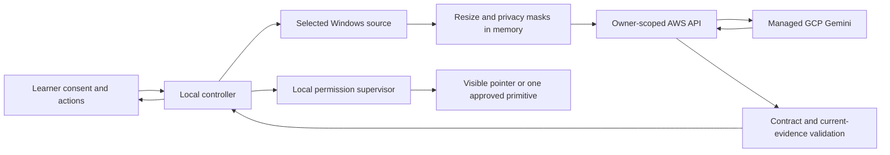

# Architecture

The Windows x64 client uses Avalonia and .NET 10. `DesktopGuide.Core` contains versioned contracts, geometry, modes, the state machine, local risk policy, and the permission supervisor. `DesktopGuide.Platform` contains interfaces, OAuth loopback handling, and the product lesson controller. `DesktopGuide.Windows` owns WGC/GDI, Win32 hooks/input, audio and DPAPI. `DesktopGuide.App` supplies consent, preview, lesson controls, approvals, account UI, overlay and tray. Tests reference fake adapters; native input is confined to Windows.

The backend uses FastAPI, SQLAlchemy, Alembic and PostgreSQL. A single worker coordinates per-session in-flight requests, short-lived response caching, two provider slots and usage reservations. Session versions prevent late inference from overwriting Stop/pause. Idempotency claims are committed before inference. Replay returns an unexpired response only for the unchanged session; an ambiguous/expired response requires a fresh observation, never an input retry.

Screen frames contain an opaque observation/scope/geometry identifier and sanitized image dimensions. Physical monitor/window rectangles, DPI and native handles stay local. Normalized targets map through content/crop bounds into physical pixels; padding, nonfinite values and out-of-range values fail. WGC is used for window capture. Monitor capture uses a disclosed GDI adapter; there is no silent window fallback. Preview, masks and source changes require local review.

The controller observes after learner activity and meaningful local screen change, with debounce and bounded automatic cadence. It asks the provider to verify previous postconditions before advancing. `I did this` is a trigger, not evidence. NOT_YET, DIFFERENT_STATE and UNCERTAIN retain the pending step. Questions preserve lesson context and cancel pending input. Resume refetches current state and observes again. Process restart restores no input authority; an unsaved session loses its in-memory goal, while saved summaries contain only milestone counts.

The permission supervisor owns epochs, cancellation and immutable action capabilities. Observation, pointing and demonstration grants are separate. Guide/Practice never dispatch an action. Demonstrate requires a local approval of an exact current proposal, valid for 15 seconds and single use. Every bounded dispatch checks epoch, focus, scope, geometry and observer availability. Stop invalidates locally before contacting AWS. Physical takeover, session lock/disconnect/suspend and observer heartbeat failure disarm locally.

Windows hook callbacks only queue events; a dedicated safety thread handles Stop/takeover. This avoids a hook callback waiting on a dispatch lock while `SendInput` waits for the hook. Input is tagged to ignore the assistant's own events. Cleanup releases only keys/buttons held by the assistant. A partially submitted primitive has an unknown outcome and requires visual verification; it is never replayed automatically.

AWS infrastructure is isolated: VPC, EC2, private database, CloudFront VPC origin, Cognito, S3 and logs. The instance's public IPv4 is for inexpensive outbound access; inbound application access is restricted by security group to CloudFront. A second apply removes the bootstrap prefix-list rule after the service-managed origin group exists. The deployed path must be tested before learner media is allowed. AWS-to-GCP federation binds the exact runtime role to a dedicated service account with inference permissions. There is no desktop cloud credential or GCP JSON key.

One instance is an intentional pilot limit, not high availability. A second worker/instance requires shared locks, atomic database budget reservations and distributed response coordination before scale-out.
